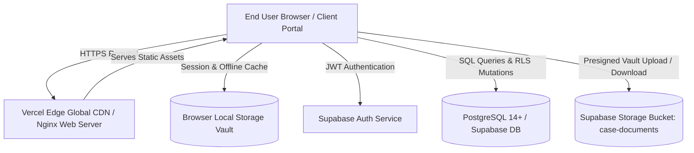
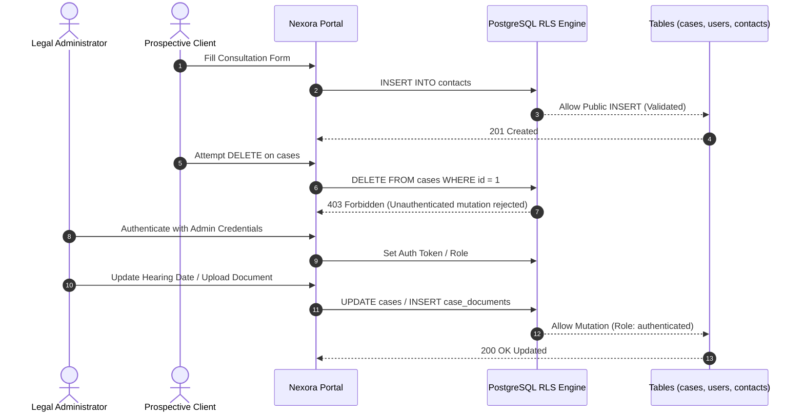

# Architecture Documentation

**Nexora Law Firm — Technical Architecture & System Design**  
*Release 1.0.2 • High-Performance Legal Practice Suite*

---

## 1. System Overview

Nexora Law Firm is architected as a lightweight, zero-latency hybrid application. It pairs a **modern static presentation front-end** with a robust, enterprise-grade **PostgreSQL / Supabase cloud backend**.

The system is designed with strict adherence to three core tenets:
1. **Zero-Build Portability**: Runs instantly from any static web server (Vercel, Nginx, Docker, Python, Node).
2. **Client Document Isolation**: Every litigant case maintains a walled-off vault with fine-grained access control.
3. **Role-Based Row Level Security (RLS)**: Enforces authentication and authorization at the database layer on every mutating endpoint.



---

## 2. Multi-Tier Layer Architecture

### 2.1 Presentation Tier (Frontend)
- **HTML5 Semantic Markup**: Accessible, standards-compliant pages (`index.html`, `cases.html`, `accelerator.html`, `odegard.html`).
- **Tailwind CSS 3.x**: Utility-first styling engine running via runtime compiler with custom design system extensions (metallic gold `#c5a059`, obsidian black `#0d0d0d`, deep burgundy `#6b1d2f`).
- **Lucide Icons**: Crisp SVG iconography integrated seamlessly into headers, action bars, and dockets.
- **Micro-Interactions**: Smooth CSS transitions, modals with backdrop blur, accordion FAQs, and animated counters.

### 2.2 Client State & Synchronization Engine
- **Dual-Mode Persistence**: The application features an automatic fallback strategy:
  - **Local Mode (Offline/Demo)**: Persists case registries, documents, and client contacts in browser `localStorage`.
  - **Cloud Sync Mode (Supabase)**: Real-time PostgreSQL persistence via `@supabase/supabase-js`.
- **Reactive UI Rendering**: Re-renders table dockets, document galleries, and hearing dates dynamically without page reloads.

### 2.3 Backend & Persistence Tier (Database)
- **Database Engine**: PostgreSQL 14+ hosted via Supabase or self-hosted PostgreSQL.
- **Relational Integrity**: 10 interconnected tables enforcing foreign key constraints, check clauses, and unique indexing.
- **Trigger Automation**: Database triggers (`set_updated_at`) automatically update `updated_at` timestamps on row mutation.

---

## 3. Security & Access Control Model



### 3.1 Row Level Security (RLS) Policies
Every table in the database has RLS explicitly enabled (`ALTER TABLE ... ENABLE ROW LEVEL SECURITY`):
- **`contacts`**: Public users may only `INSERT` valid inquiry records. Viewing (`SELECT`), updating status, or deleting records requires `authenticated` staff permissions.
- **`cases` & `case_documents`**: Reading is permitted for authenticated portal users; modifying or deleting case dockets and legal briefs strictly requires authenticated management roles.
- **`audit_logs`**: Write-only for security audit tracking; historical entries cannot be updated or purged by client roles.

---

## 4. Deployment Topologies

Nexora Law Firm supports multiple deployment architectures:

### 4.1 Topology A: Vercel Edge (Serverless / Static CDN)
- Ideal for cloud-native zero-maintenance hosting.
- Configuration handled via [`vercel.json`](vercel.json):
  ```json
  {
    "cleanUrls": true,
    "buildCommand": null,
    "outputDirectory": "."
  }
  ```

### 4.2 Topology B: Docker Container (Microservice / Kubernetes)
- Lightweight Alpine Nginx image configured via [`Dockerfile`](Dockerfile) and [`docker-compose.yml`](docker-compose.yml).
- Self-contained with built-in health checks (`/health`), gzip compression, and security headers.

### 4.3 Topology C: Dedicated VPS (Ubuntu Linux + Nginx)
- Full step-by-step installation instructions documented in [`HowToSetup.md`](HowToSetup.md).
- Automated SSL certificate management through Let's Encrypt and Certbot.
