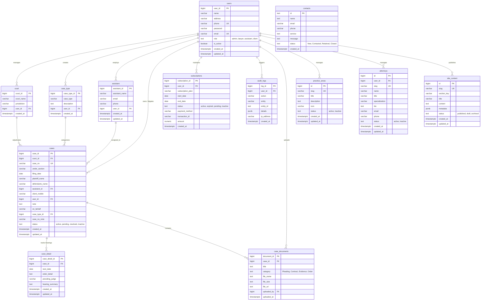

# Entity Relationship Diagram (ERD)

**Nexora Law Firm — Database Architecture**  
*PostgreSQL 14+ / Supabase Schema Definition*

---

## 1. Visual Entity Relationship Diagram

---

## 2. Table Specifications & Schema Dictionary

### 2.1 `users`
Primary authentication and identity table managing access tiers.
- **`user_id`** (BIGINT, PK, Generated by Default): Unique identifier.
- **`name`** (VARCHAR(100), NOT NULL): Full legal name of user or lawyer.
- **`phone`** (VARCHAR(30), UNIQUE, NOT NULL): Contact phone number.
- **`email`** (VARCHAR(120), UNIQUE, NOT NULL): Login and notification email.
- **`password`** (VARCHAR(255), NOT NULL): Secure hashed password credential.
- **`role`** (TEXT, CHECK): Role designation (`admin`, `lawyer`, `assistant`, `client`).
- **`is_active`** (BOOLEAN, DEFAULT TRUE): Soft-disable toggle.

### 2.2 `court`
Master register of courts, tribunals, arbitral forums, and judicial districts.
- **`court_id`** (BIGINT, PK, Generated by Default): Court record identifier.
- **`court_name`** (VARCHAR(255), NOT NULL): Full court title.
- **`jurisdiction`** (VARCHAR(150)): Jurisdiction tier (e.g., Federal, State, District).
- **`user_id`** (BIGINT, FK -> `users.user_id`): Creator/administrator reference.

### 2.3 `case_type`
Practice classification index (e.g., Corporate Litigation, Criminal Defense, Intellectual Property).
- **`case_type_id`** (BIGINT, PK, Generated by Default): Classification identifier.
- **`case_type`** (VARCHAR(100), NOT NULL): Specialty title.
- **`description`** (TEXT): Practice area scope details.
- **`user_id`** (BIGINT, FK -> `users.user_id`): Creator reference.

### 2.4 `assistant`
Registry of assigned paralegals, associates, researchers, and legal clerks.
- **`assistant_id`** (BIGINT, PK, Generated by Default): Legal staff identifier.
- **`assistant_name`** (VARCHAR(255), NOT NULL): Full staff name.
- **`email`** (VARCHAR(120)): Corporate email address.
- **`phone`** (VARCHAR(30)): Dedicated work phone.
- **`user_id`** (BIGINT, FK -> `users.user_id`): Creator reference.

### 2.5 `cases`
Central docket registry recording all ongoing and resolved legal matters.
- **`case_id`** (BIGINT, PK, Generated by Default): Internal matter identifier.
- **`court_id`** (BIGINT, FK -> `court.court_id`): Associated court forum.
- **`case_no`** (VARCHAR(100), UNIQUE, NOT NULL): Official filing docket number.
- **`under_section`** (VARCHAR(150), NOT NULL): Legal section, statute, or cause of action.
- **`filing_date`** (DATE, NOT NULL): Date of docket initiation.
- **`plaintiff_name`** (VARCHAR(150), NOT NULL): Moving party / claimant.
- **`defendants_name`** (VARCHAR(150), NOT NULL): Adverse party / respondent.
- **`assistant_id`** (BIGINT, FK -> `assistant.assistant_id`, NULLABLE): Assigned paralegal.
- **`client_mobile`** (VARCHAR(30), NOT NULL): Client identification mobile number.
- **`user_id`** (BIGINT, FK -> `users.user_id`): Lead attorney reference.
- **`case_type_id`** (BIGINT, FK -> `case_type.case_type_id`): Specialty reference.
- **`status`** (TEXT, CHECK): Current state (`active`, `pending`, `resolved`, `inactive`).

### 2.6 `case_detail`
Chronological hearing proceedings diary, courtroom orders, and judge notes.
- **`case_detail_id`** (BIGINT, PK, Generated by Default): Hearing log entry identifier.
- **`case_id`** (BIGINT, FK -> `cases.case_id`, ON DELETE CASCADE): Parent case docket.
- **`next_date`** (DATE, NOT NULL): Scheduled subsequent hearing or deadline date.
- **`order_detail`** (TEXT): Court orders, judgments, and legal directives issued.
- **`presiding_judge`** (VARCHAR(150)): Judge or tribunal commissioner presiding.

### 2.7 `case_documents`
Isolated client document vault attachments (pleadings, affidavits, evidence, contracts).
- **`document_id`** (BIGINT, PK, Generated by Default): Vault record identifier.
- **`case_id`** (BIGINT, FK -> `cases.case_id`, ON DELETE CASCADE): Target case docket.
- **`title`** (TEXT, NOT NULL): Display title of legal instrument.
- **`category`** (TEXT, NOT NULL): Document classification (`Pleading`, `Contract`, `Evidence`).
- **`file_name`** (TEXT, NOT NULL): Original filename with extension.
- **`file_size`** (TEXT): Formatted size string (e.g., `2.4 MB`).
- **`file_url`** (TEXT, NOT NULL): Supabase Storage URL or encrypted storage path.
- **`uploaded_by`** (BIGINT, FK -> `users.user_id`): Uploader account reference.

### 2.8 `contacts`
Inbound prospective client consultations and web inquiry requests.
- **`id`** (TEXT, PK): Unique inquiry identifier.
- **`name`** (TEXT, NOT NULL): Inquirer full name.
- **`email`** (VARCHAR(120)): Inquirer email address.
- **`phone`** (VARCHAR(30)): Inquirer telephone number.
- **`service`** (TEXT): Practice area or requested legal assistance.
- **`message`** (TEXT): Confidential brief or inquiry content.
- **`status`** (TEXT, CHECK): Intake workflow state (`New`, `Contacted`, `Retained`, `Closed`).

### 2.9 `subscriptions`
Client retainers, billing tier records, and enterprise service subscriptions.
- **`subscription_id`** (BIGINT, PK, Generated by Default): Subscription identifier.
- **`user_id`** (BIGINT, FK -> `users.user_id`): Account reference.
- **`subscription_plan`** (VARCHAR(50), NOT NULL): Plan tier name.
- **`start_date`** (DATE, NOT NULL): Effective commencement date.
- **`end_date`** (DATE, NOT NULL): Expiration date.
- **`status`** (TEXT, CHECK): Status (`active`, `expired`, `pending`, `inactive`).
- **`amount`** (NUMERIC(10,2), NOT NULL): Retainer fee amount.

### 2.10 `audit_logs`
Immutable compliance and governance audit trail recording all mutating actions.
- **`log_id`** (BIGINT, PK, Generated by Default): Audit record identifier.
- **`user_id`** (BIGINT, FK -> `users.user_id`, NULLABLE): Operating user ID.
- **`action`** (VARCHAR(50), NOT NULL): Action verb (`INSERT`, `UPDATE`, `DELETE`, `LOGIN`).
- **`entity`** (VARCHAR(50), NOT NULL): Target table or entity name.
- **`entity_id`** (TEXT): Identifier of affected entity record.
- **`details`** (JSONB): Structured payload diff or event metadata.
- **`ip_address`** (VARCHAR(45)): Client IP address.

---

## 3. Referential Integrity & Deletion Rules

1. **Cascade Deletions (`ON DELETE CASCADE`)**:
   - Deleting a row from `cases` will automatically remove corresponding `case_detail` hearing history and `case_documents` vault files.
2. **Restricted Deletions (`ON DELETE RESTRICT`)**:
   - `users`, `court`, and `case_type` cannot be deleted if referenced by existing active `cases`, preserving the integrity of legal records.
3. **Nullified References (`ON DELETE SET NULL`)**:
   - Removing an `assistant` or `uploaded_by` user safely unlinks the record without destroying case data.
